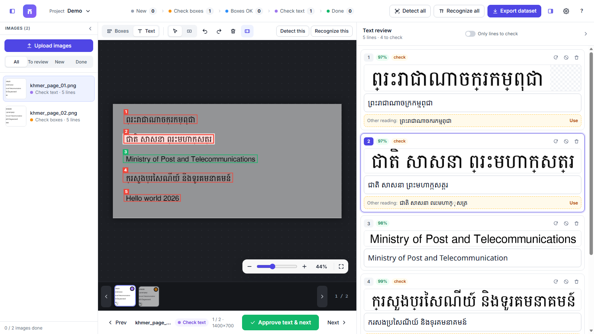
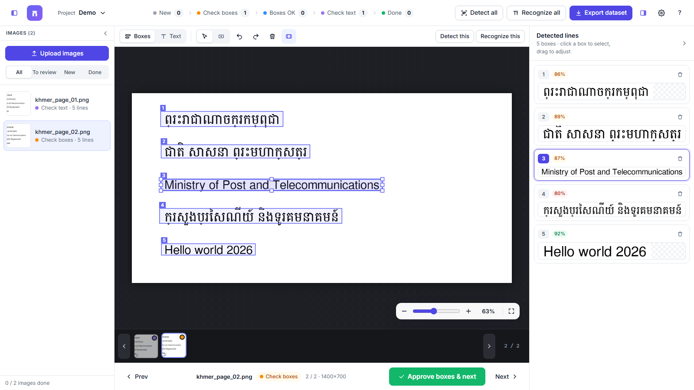
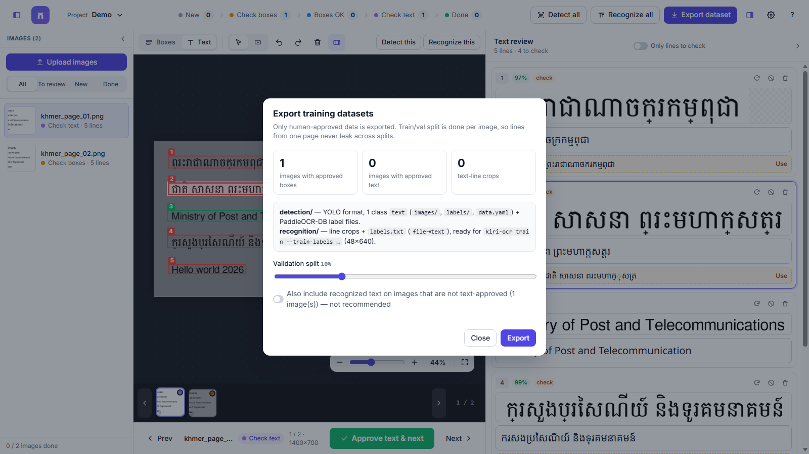

<div align="center">

# Khmer OCR Studio

**Khmer text detection & recognition: build, review and export OCR training data**

Upload page images → detect text lines → check the boxes → recognize the text → fix it → export ready-to-train datasets.

[](LICENSE)

[](https://huggingface.co/mrrtmob/kiri-ocr)

</div>



Khmer OCR Studio is a local web app for making **Khmer (and Khmer-English) OCR datasets**.
Machine learning models do the first pass. You review and correct the results in a fast, keyboard-friendly editor,
then export clean data to train or fine-tune:

- a **text-line detector**: YOLO format with one class `text`, plus PaddleOCR-DB labels;
- a **text-line recognizer**: line crops with their transcription, in the format the
  [kiri-ocr](https://github.com/mrrtmob/kiri-ocr) trainer reads.

> **Models:** detection and recognition use the open-source
> [**kiri-ocr**](https://huggingface.co/mrrtmob/kiri-ocr) models by **mrrtmob**.
> This project is a separate tool built on top of them. See [Acknowledgements](#acknowledgements).

---

## Contents
- [Features](#features)
- [Quick start](#quick-start)
- [Workflow](#workflow)
- [Exported datasets](#exported-datasets)
- [Training with the exported data](#training-with-the-exported-data)
- [Keyboard shortcuts](#keyboard-shortcuts)
- [Settings](#settings)
- [Project structure](#project-structure)
- [Contributing](#contributing)
- [Acknowledgements](#acknowledgements)
- [License](#license)

## Features

- **Batch processing.** Upload many images at once, with a preview to check them and drop unwanted ones first.
  Run **Detect all** and **Recognize all** in the background, with a progress bar and cancel button.
- **Box editor.** Move, resize, draw and delete line boxes. Undo/redo, zoom at the cursor, scroll and pan.
- **Text review.** Every line shows its image crop above an editable text field in a Khmer font.
- **Smart flags.** A line is flagged **check** when its confidence is low, or when the two recognizer decoders
  (attention decoder and CTC) disagree. The other reading is offered as a one-click fix.
- **Pipeline tracking.** Each image moves through *New → Check boxes → Boxes OK → Check text → Done*;
  click a stage to filter the list.
- **Approve & next** (`Enter`) jumps to the next image that still needs review.
- **Clean exports.** Only approved data is exported. The train/val split is made per image, so lines from one
  page never appear in both splits.
- **Matching crops.** Exported line crops are cut exactly like kiri-ocr cuts them at inference
  (box + padding, dark backgrounds inverted).
- **Comfortable layout.** Resizable, collapsible panels (drag the borders; `Ctrl+B` / `Ctrl+Alt+B`), a filmstrip,
  and autosave.
- **Fully local.** Images and annotations stay on your machine (`data/`). The internet is only needed once,
  to download the models.

<table>
<tr>
<td></td>
<td></td>
</tr>
<tr><td align="center">Box review</td><td align="center">Export</td></tr>
</table>

## Quick start

Requirements: **Python 3.10+**. An NVIDIA GPU is optional.

**Windows**
```bat
git clone https://github.com/PhonSobon/Khmer-OCR-Studio.git
cd Khmer-OCR-Studio
run.bat
```

**Linux / macOS**
```bash
git clone https://github.com/PhonSobon/Khmer-OCR-Studio.git
cd Khmer-OCR-Studio
sh run.sh
```

The first run creates a virtual environment in `.venv`, installs `requirements.txt` and opens
<http://127.0.0.1:8000>. The models are downloaded from Hugging Face the first time you run detection or recognition.

- If the app is already running, the launcher just opens the browser.
- If port 8000 is busy, it uses the next free port. You can also pick one: `run.bat 8080` or `sh run.sh 8080`.

<details>
<summary>Manual install</summary>

```bash
python -m venv .venv
# Windows: .venv\Scripts\activate    Linux/macOS: source .venv/bin/activate
pip install -r requirements.txt
python -m app.launch            # or: uvicorn app.main:app --port 8000
```
</details>

<details>
<summary>GPU (CUDA) acceleration</summary>

pip installs the CPU build of PyTorch by default. For an NVIDIA GPU, install a CUDA build, for example:

```bash
pip install torch --index-url https://download.pytorch.org/whl/cu124 --force-reinstall
```
Then choose **Settings → Device → auto** (or `cuda`). Detection uses `onnxruntime-gpu` when CUDA is available.
</details>

## Workflow

| Step | What you do | What happens |
|---|---|---|
| 1. **Upload** | Click *Upload images* or drag files into the window | A preview opens; remove any images you don't want, then upload. You can turn on *Run detection right after upload*. |
| 2. **Detect all** | Choose *new images*, *all not approved yet*, or *every image* | The kiri-ocr **DB detector** (`detector/DB/detector.onnx`) finds one box per text line. |
| 3. **Check boxes** | Fix, draw (`B`), delete (`Del`) or resize boxes, then press `Enter` | The boxes are approved and the next image to review opens. |
| 4. **Recognize all** | Choose *approved images* (recommended) or *all images with boxes* | The kiri-ocr **recognizer** (Transformer + CTC, 48×640 input) reads every line crop. |
| 5. **Check text** | Correct each line; use **Use** on the other reading when it is right; press `Enter` | The text is approved. Lines you mark *ignore* stay as detection boxes but are left out of the recognition set. |
| 6. **Export** | Click *Export dataset*, pick the validation split | Datasets are written to `data/exports/…`, plus a `.zip` to download. |

## Exported datasets

```
data/exports/<project>_<timestamp>/        (and <project>_<timestamp>.zip)
├── README.txt                             summary and training commands
├── stats.json
├── detection/
│   ├── data.yaml                          YOLO: nc: 1, names: ['text']
│   ├── images/{train,val}/*.png|jpg
│   ├── labels/{train,val}/*.txt           "0 cx cy w h"  (normalised 0–1, one line per text line)
│   └── {train,val}_label.txt              PaddleOCR det format:
│                                          images/train/x.png<TAB>[{"transcription": "...", "points": [[x,y]×4]}]
└── recognition/
    ├── charset.txt                        all characters used
    ├── train/
    │   ├── images/*.png                   line crops
    │   ├── labels.txt                     "<file name><TAB><text>"   (kiri-ocr format)
    │   └── metadata.jsonl                 {"file_name": "images/…", "text": "…"}  (HF imagefolder)
    └── val/  (same layout)
```

- Text is Unicode **NFC**-normalised, and tabs and newlines are removed.
- Only images whose boxes you approved go into `detection/`.
- Only images whose text you approved go into `recognition/`. The export dialog has an option to override this.

## Training with the exported data

**Detector: YOLO (Ultralytics)**
```bash
pip install ultralytics
yolo detect train data=detection/data.yaml model=yolov8n.pt imgsz=1024 epochs=100
```
`data.yaml` contains an absolute `path:`. Edit it if you move the folder.

**Detector: DB / PaddleOCR.** Use `detection/train_label.txt` and `detection/val_label.txt`, with `detection/` as the data directory.
This is the same family of model as the kiri-ocr `detector.onnx`.

> Note: kiri-ocr's own `kiri-ocr train-detector` command trains a CRAFT model from its own generated data format,
> not the DB model, so use one of the options above for this export.

**Recognizer: kiri-ocr**
```bash
cd recognition
kiri-ocr train --train-labels train/labels.txt --val-labels val/labels.txt \
    --height 48 --width 640 --output-dir output_model --device cuda
# add  --from-model <path/to/model.safetensors>  to fine-tune the released weights
```
To use your fine-tuned model in the app, go to **Settings → Recognition model** and enter
`output_model/model.safetensors`. A custom detector ONNX can be set the same way.

**Hugging Face datasets**
```python
from datasets import load_dataset
ds = load_dataset("imagefolder", data_dir="recognition")   # uses metadata.jsonl
```

## Keyboard shortcuts

Press `?` in the app for the full list.

| Key | Action |
|---|---|
| `Enter` / `Ctrl+Enter` | Approve and go to the next image to review |
| `←` `→` · `PgUp` `PgDn` | Previous / next image |
| `1` / `2` | Boxes mode / Text mode |
| `B` · `V` · `Esc` | Draw-box tool · select tool · deselect |
| `Del` | Delete the selected box |
| Arrow keys (box selected) | Nudge 1 px (`Shift` = 10 px, `Alt` = resize) |
| `Tab` / `Shift+Tab` | Next / previous line |
| `Ctrl+Z` / `Ctrl+Shift+Z` | Undo / redo |
| Wheel · `Shift`+wheel | Scroll up/down · left/right |
| `Ctrl`+wheel · `+` `-` | Zoom at the cursor |
| `F` · `W` · `0` | Fit page · fit width · 100% |
| `R` | Recognize all lines of the current image |
| `Ctrl+B` / `Ctrl+Alt+B` | Show / hide the Images panel / the Lines panel |
| Drag a panel border | Resize the panel; double-click the border to reset |

## Settings

Open them from the ⚙ icon. They are saved to `data/settings.json`.

| Setting | Default | Notes |
|---|---|---|
| Recognition decoding | `accurate` | `fast` = CTC only, `accurate` = attention decoder, `beam` = beam search (slowest) |
| Device | `auto` | `auto` / `cpu` / `cuda` |
| Pixel threshold / Box threshold | 0.3 / 0.5 | DB detector thresholds; lower values find fainter text |
| Unclip ratio | 1.5 | Higher values give larger boxes |
| Max image side | 960 | Raise it for pages with small text |
| Line crop padding | 5 px | Used for recognition and for exported crops |
| Recognition model / Detector ONNX | `mrrtmob/kiri-ocr` | A Hugging Face repo ID or a local path |

## Project structure

```
app/
  main.py        FastAPI routes (projects, images, jobs, export)
  engine.py      kiri-ocr wrapper: DB detector, recognizer, line cropping
  jobs.py        background worker for batch detection / recognition
  storage.py     file-based projects  (data/projects/<id>/project.json)
  exporter.py    YOLO / PaddleOCR / kiri-ocr dataset export
  launch.py      launcher (port check, opens the browser)
static/          single-page UI: index.html, styles.css, app.js (no build step)
docs/            screenshots
run.bat, run.sh  one-click start
```

## Contributing

Issues and pull requests are welcome. Ideas that would help:
rotated or polygon boxes, word-level boxes, multi-user review, active learning (review the least-confident lines first),
more export formats, and translating the UI to Khmer.

1. Fork the repo and create a branch.
2. Keep the UI dependency-free: plain HTML, CSS and JavaScript, no build step.
3. Please don't commit `data/`. It contains user images and is ignored by git.

## Acknowledgements

This project would not exist without the following open-source work.

- **[kiri-ocr](https://github.com/mrrtmob/kiri-ocr)** by **mrrtmob**: the Khmer/English OCR models and Python
  package used for all detection and recognition in this app.
  - Model: <https://huggingface.co/mrrtmob/kiri-ocr>, which includes the DB text detector
    ([`detector/DB/detector.onnx`](https://huggingface.co/mrrtmob/kiri-ocr/tree/main/detector/DB)) and the
    Transformer + CTC line recognizer.
  - Code: <https://github.com/mrrtmob/kiri-ocr>
  - License: Apache-2.0. The models are downloaded at runtime and are **not** redistributed in this repository.
  - Training data used by kiri-ocr: [`mrrtmob/khmer_english_ocr_image_line`](https://huggingface.co/datasets/mrrtmob/khmer_english_ocr_image_line)
- [FastAPI](https://fastapi.tiangolo.com/), [Uvicorn](https://www.uvicorn.org/), [PyTorch](https://pytorch.org/),
  [ONNX Runtime](https://onnxruntime.ai/), [OpenCV](https://opencv.org/), [Pillow](https://python-pillow.org/)
- Fonts: [Noto Sans Khmer](https://fonts.google.com/noto/specimen/Noto+Sans+Khmer) and
  [Inter](https://rsms.me/inter/) (SIL Open Font License), loaded from Google Fonts.

Khmer OCR Studio is an independent project. It is not affiliated with or endorsed by the kiri-ocr authors.

### Citing

If you use the models in research, please cite **kiri-ocr**:

```bibtex
@software{kiri_ocr,
  author = {mrrtmob},
  title  = {Kiri OCR: Khmer and English OCR},
  url    = {https://github.com/mrrtmob/kiri-ocr},
  note   = {Models: https://huggingface.co/mrrtmob/kiri-ocr}
}
```

## License

Khmer OCR Studio is released under the [Apache License 2.0](LICENSE).
The kiri-ocr package and models are licensed separately by their authors under Apache-2.0.
